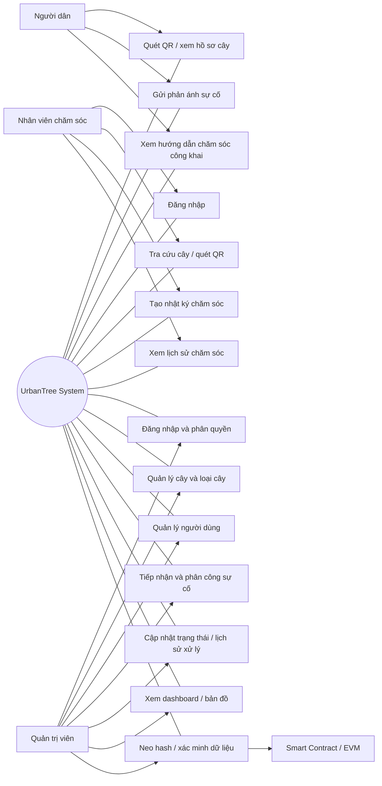
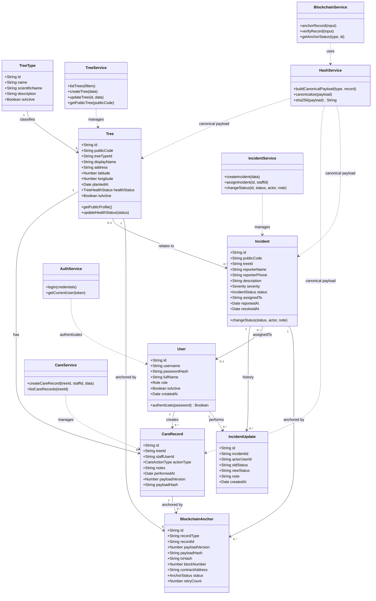
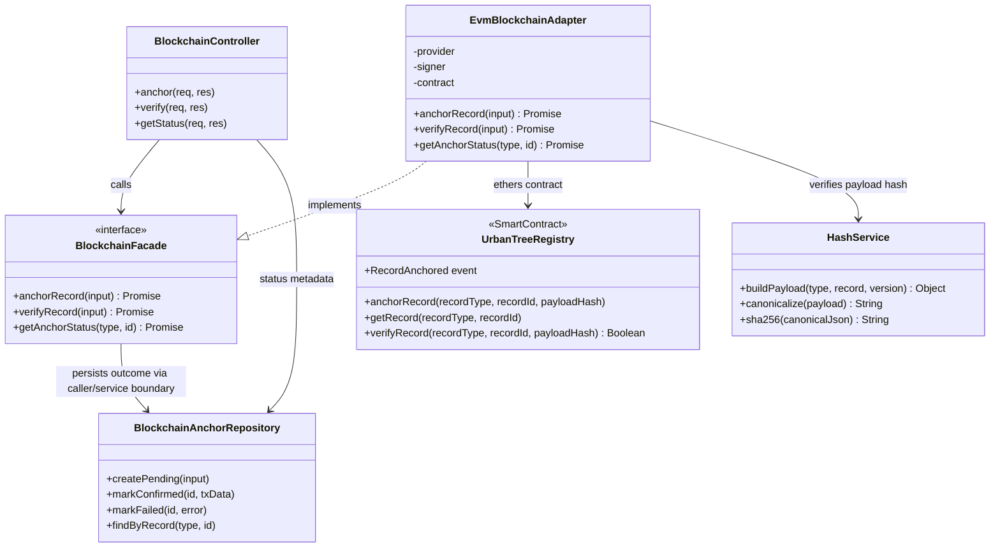
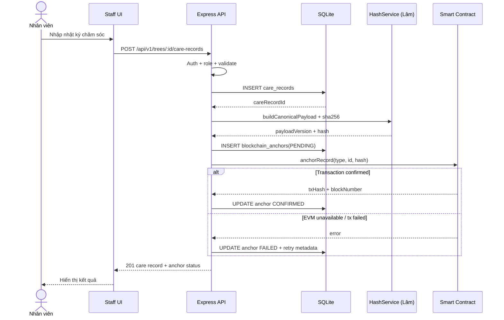
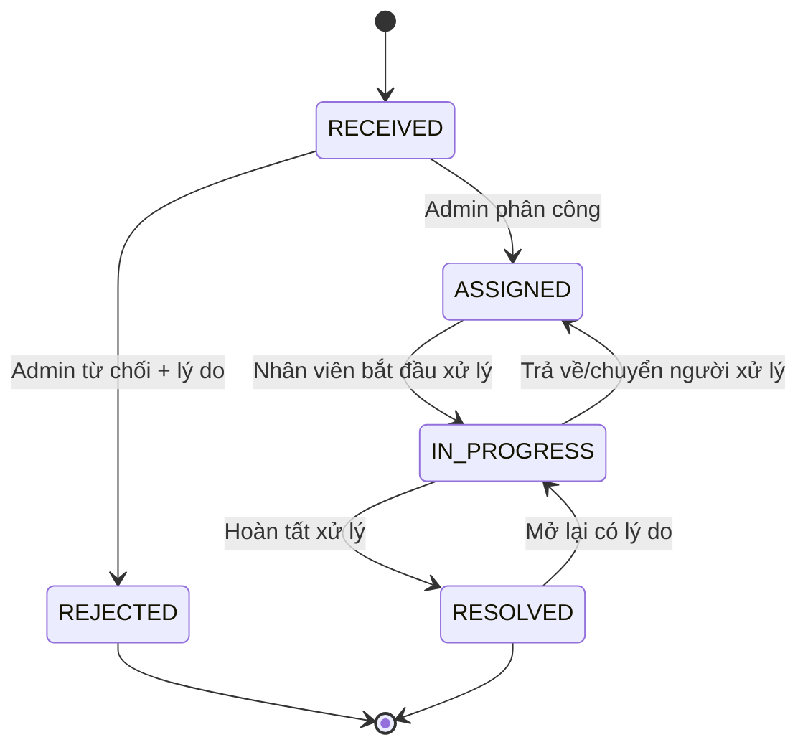

# URBANTREE — ROADMAP ĐỒ ÁN 4 TRONG 20 NGÀY
## Kế hoạch triển khai MVP, tích hợp, kiểm thử và bảo vệ — 2 thành viên

**Phiên bản:** 2.0 — Bản hợp nhất, chốt phân công và quy trình phối hợp Git  
**Thời lượng:** 20 ngày làm việc liên tục (có thể quy đổi thành 20 buổi nếu lịch học không cho phép)  
**Nhân lực:** 2 thành viên  
**Sản phẩm:** UrbanTree — Hệ thống quản lý cây xanh đô thị tích hợp QR Code và Blockchain  
**Ưu tiên:** Có MVP chạy ổn định, chứng minh được luồng nghiệp vụ đầu-cuối và bảo vệ được quyết định kỹ thuật.  
**Nguyên tắc:** Không chạy theo số lượng màn hình. Ưu tiên luồng chạy thật, dữ liệu nhất quán, bằng chứng kiểm thử và demo có thể lặp lại.

---

# 0. Cách dùng roadmap

- Mỗi ngày phải tạo ra **đầu ra kiểm chứng được** (code, API, migration, test, tài liệu/kiểm thử, tài liệu hoặc video/screenshot).
- Hai thành viên làm song song theo phân quyền ở mục 4. Không cùng sửa một file hoặc một module trong cùng thời điểm.
- Cuối mỗi ngày có 15–30 phút tích hợp: cập nhật trạng thái, chạy smoke test, ghi blocker và chốt việc ngày sau.
- Không đánh dấu `DONE` chỉ vì AI đã sinh code hoặc Figma đã render. Chỉ `DONE` khi đã chạy/đọc lại/kiểm thử và lưu bằng chứng.
- Nếu phát hiện codebase hiện tại khác tài liệu, **hiện trạng repository và hành vi chạy được là nguồn quyết định**; ghi lại quyết định, không tự ý đổi stack giữa chừng.
- Roadmap 20 ngày là kế hoạch nén để hoàn thành **MVP đồ án**, không phải cam kết production-ready hoặc vận hành quy mô thành phố.

## Định nghĩa trạng thái

| Trạng thái | Ý nghĩa |
|---|---|
| TODO | Chưa bắt đầu |
| DOING | Đang thực hiện, có người phụ trách |
| BLOCKED | Bị chặn bởi phụ thuộc; phải ghi rõ nguyên nhân và người gỡ |
| REVIEW | Đã làm, chờ người còn lại kiểm tra |
| DONE | Đã kiểm thử và có bằng chứng |
| DEFERRED | Chủ động đưa ra ngoài MVP, có lý do |

---

# 1. Mục tiêu sản phẩm và phạm vi khóa

## 1.1. Bài toán

Thông tin cây xanh phân tán, khó tra cứu lịch sử chăm sóc; người dân khó gửi phản ánh đúng cây/vị trí; đơn vị quản lý khó theo dõi phân công và chứng minh bản ghi quan trọng có bị thay đổi sau khi ghi nhận hay không.

UrbanTree tạo hồ sơ cây có mã định danh và QR riêng; nhân viên quét QR để cập nhật chăm sóc; người dân mở web từ QR để tra cứu và gửi phản ánh; Admin quản lý cây, tiếp nhận/phân công/xử lý sự cố; các bản ghi quan trọng được băm SHA-256 và neo hash lên EVM local để đối chiếu toàn vẹn.

## 1.2. MVP bắt buộc phải trình diễn được

1. Admin đăng nhập và được phân quyền.
2. Admin xem dashboard từ dữ liệu backend.
3. CRUD cây xanh và danh mục loài cây ở mức cần thiết.
4. Mỗi cây có mã công khai/QR ổn định; quét QR mở đúng trang cây công khai.
5. Bản đồ hiển thị cây/sự cố từ tọa độ có trong dữ liệu.
6. Nhân viên đăng nhập, xem cây/nhiệm vụ và ghi nhận chăm sóc.
7. Người dân không cần tài khoản, xem cây và gửi phản ánh kèm mô tả/ảnh/vị trí (theo khả năng storage đã xác nhận).
8. Admin xem phản ánh, cập nhật trạng thái, phân công hoặc ghi nhận người xử lý.
9. Lịch sử cập nhật sự cố được lưu; không ghi đè mất dấu vết trạng thái cũ.
10. Tính SHA-256 trên payload chuẩn hóa; ghi hash của bản ghi đã chốt lên Smart Contract.
11. Trang xác minh tính lại hash từ dữ liệu hiện tại và so sánh với bằng chứng đọc từ contract.
12. Có dữ liệu demo, hướng dẫn chạy, test report, kịch bản demo và phương án dự phòng khi node Blockchain không chạy.

## 1.3. Ngoài phạm vi 20 ngày

- AI nhận diện bệnh cây/dự báo cây ngã đổ.
- IoT/cảm biến, tích hợp cơ sở dữ liệu nhà nước.
- Blockchain public mainnet, token, ví người dân, thanh toán.
- SMS/Zalo trả phí, thông báo production.
- Tối ưu tuyến xe cứu hộ hoặc cam kết SLA ngoài đời thực.
- Ứng dụng người dân riêng; người dân dùng web responsive.
- Offline-first hoàn chỉnh cho Staff App nếu chưa có nền tảng và thiết bị kiểm thử. Có thể mô phỏng trạng thái mất mạng trên UI, nhưng phải ghi rõ demo/prototype nếu chưa đồng bộ thật.
- Báo cáo nâng cao, export PDF/CSV, AI, phân tích quy hoạch.

**Quy tắc cắt giảm:** Nếu trễ tiến độ, cắt tính năng mở rộng và polish trước; không cắt bảo mật, tính toàn vẹn dữ liệu, test luồng chính, tài liệu chạy và demo.

---

# 2. Kiến trúc và các quyết định phải khóa ngay ngày 1

## 2.1. Xung đột được phát hiện khi hợp nhất tài liệu

Các tài liệu được cung cấp chưa hoàn toàn thống nhất. Đây là những điểm phải xử lý, không được âm thầm bỏ qua:

| Hạng mục | Tài liệu đang thể hiện | Rủi ro | Cách khắc phục bắt buộc |
|---|---|---|---|
| Backend | Roadmap/README có Java 17/21 + Spring Boot 3; tài liệu phân công lại mô tả Node.js/Express và cấu trúc `server.js`, `controllers`, `routes` | Viết sai stack, mất thời gian chuyển đổi | Ngày 1 kiểm tra `package.json`, `pom.xml`/Gradle, entrypoint và source đang chạy. Chọn **một** stack theo codebase hiện hữu; ghi ADR-001. Không migrate trong 20 ngày nếu chưa có lý do bắt buộc. |
| Database | Roadmap tổng thể ghi MySQL 8 + JPA/Flyway; phân công ghi SQLite và `urbantree.db` | Schema, query, migration và hướng dẫn chạy không khớp | Chọn DB theo backend hiện tại. Nếu repo đã chạy SQLite thì giữ SQLite cho MVP; nếu đã có Spring/JPA/MySQL chạy được thì giữ MySQL. Chỉ một DB chính thức trong demo. |
| Phân công file | Tài liệu phân công quy định Thuận sở hữu DB/controllers; Lâm sở hữu contracts/hash/blockchain | Xung đột khi sửa router/service tích hợp | Giữ ma trận quyền ở mục 4; file giao tiếp phải có owner rõ. Thay đổi contract/API cần PR và review của cả hai. |
| Hashing | Có tài liệu ghép chuỗi theo thứ tự trường; roadmap cập nhật yêu cầu canonical payload có version, chuẩn hóa null/chuỗi/ngày giờ | Hash khác nhau giữa hai môi trường hoặc khi thêm field | Chốt schema payload có version và test vector cố định; không hash trực tiếp object ORM/JPA. |
| Blockchain | Một số mô tả lưu hash của TREE_PROFILE/CARE_LOG/INCIDENT_REPORT; roadmap mở rộng có CARE/INCIDENT/RESOLUTION và blockchain audit | Loại bản ghi không thống nhất, verify sai loại | MVP chốt tối đa `TREE_PROFILE`, `CARE`, `INCIDENT`, `RESOLUTION`; chỉ triển khai loại nào có dữ liệu và test. Dùng enum/constant duy nhất. |
| Public screen ID | Prompt pack/roadmap có mapping P01–P04/P05 khác nhau | Link prototype và frontend lệch màn hình | Không tự renumber. Chốt Screen Inventory theo Figma đang có; lưu bảng mapping ID → route → mục đích trong ngày 2. |
| Màu sắc | Có palette Verdant Starry Night khác nhau giữa tài liệu | UI không đồng nhất | Chọn một palette đã được duyệt trong Figma; nếu chưa có, dùng palette prompt pack `#174B36`, `#347A50`, `#4C956C`, `#F3E8B2`, `#F6F5EC`, `#E0EBDD` làm đề xuất duy nhất. |
| Figma | Có số liệu prototype/frame được mô tả như kết quả hoàn tất ở một số tài liệu; prompt pack lại yêu cầu xác minh thực tế | Tưởng đã hoàn thành nhưng không có bằng chứng | Ngày 1–2 kiểm tra trực tiếp file Figma. Gắn `VERIFIED`, `NOT VERIFIED`, `MISSING`; không lấy số liệu trong tài liệu làm bằng chứng hiện trạng. |
| Staff Mobile | Có tài liệu Flutter Offline-First Hive/Isar; phạm vi khác mô tả PWA/mobile responsive | Phát sinh một app hoàn chỉnh ngoài khả năng | Chốt Flutter hay PWA theo codebase hiện hữu. Trong 20 ngày chỉ làm luồng scan → tree detail → care record nếu nền tảng đã sẵn. |
| “60 phút cứu hộ” | README/đặc tả mô tả mục tiêu điều phối trong 60 phút | Dễ biến thành cam kết hệ thống | Trình bày là mục tiêu nghiệp vụ/giả lập trong demo, không tuyên bố SLA thực tế nếu không có đội vận hành và dữ liệu thực. |

## 2.2. Quy tắc chọn stack

**Thứ tự quyết định:**
1. Source code đang chạy và có test.
2. Cấu hình dependency/lockfile hiện hữu.
3. Tài liệu kiến trúc đã được nhóm xác nhận.
4. Chỉ khi repository trống hoặc không thể chạy mới chọn stack theo roadmap.

**Không được:** vừa dùng Spring Boot vừa thêm Express cho cùng nghiệp vụ; vừa lưu MySQL vừa SQLite mà không có mục đích rõ; thay framework hoặc DB chỉ vì tài liệu khác ghi khác.

## 2.3. Kiến trúc logic MVP

`Admin Web / Public Web / Staff App` → `REST API` → `Business Services` → `Database`

`Business Services` → `Hash Service (SHA-256)` → `Blockchain Client` → `Hardhat Local EVM / Smart Contract`

- Database lưu dữ liệu nghiệp vụ và metadata giao dịch.
- Blockchain chỉ lưu dấu vân tay/hash và metadata tối thiểu; **không** lưu ảnh, số điện thoại, mô tả riêng tư hoặc toàn bộ hồ sơ.
- Ảnh lưu ở file storage riêng; database chỉ lưu đường dẫn/URL và metadata.
- API công khai chỉ trả trường được phép công khai.
- Blockchain local là môi trường demo, không phải mainnet hoặc hệ thống phi tập trung đang vận hành ngoài đời.

## 2.4. Các nguyên tắc kỹ thuật phải giữ

- UUID hoặc ID ổn định cho bản ghi; mã cây công khai không dùng làm bí mật.
- QR chứa URL định danh công khai, không chứa token, số điện thoại hay dữ liệu nội bộ.
- Password dùng BCrypt/PasswordEncoder; không lưu mật khẩu thô.
- JWT/Session phải có hạn sử dụng; backend kiểm tra role trên từng endpoint, không chỉ ẩn nút ở frontend.
- Validate dữ liệu đầu vào ở backend; giới hạn loại/kích thước file upload.
- CORS chỉ cho origin cần thiết; không dùng wildcard kèm credentials.
- Dùng migration/DDL có version; có seed data riêng cho demo.
- Cập nhật trạng thái sự cố và tạo `incident_updates` phải nhất quán trong transaction DB.
- Blockchain transaction có thể thất bại sau khi DB đã ghi: cần trạng thái `PENDING/FAILED/CONFIRMED` và retry có kiểm soát.
- Không sửa âm thầm bản ghi đã neo hash; đính chính bằng bản ghi mới hoặc version mới.
- Có timeout/error handling khi node EVM mất kết nối.
- Không commit `.env`, private key, database thật, ảnh cá nhân hoặc file build lớn lên Git.

---

# 3. Thiết kế dữ liệu và API tối thiểu

## 3.1. Các thực thể dữ liệu

| Thực thể | Trường cốt lõi gợi ý | Ghi chú |
|---|---|---|
| `users` | id, username/email, password_hash, full_name, role, status, created_at | ADMIN/STAFF; không trả password_hash qua API |
| `tree_types` | id, name, scientific_name, description, care_guide, status | Không xóa loại cây đã được tham chiếu; chuyển inactive |
| `trees` | id, public_code, tree_type_id, name, address, latitude, longitude, planted_at, health_status, image_url, status, created_at, updated_at | `public_code` unique; tọa độ có validation |
| `care_records` | id, tree_id, staff_id, care_type, health_before, health_after, note, image_before_url, image_after_url, created_at, data_hash, anchor_status | Bản ghi chăm sóc |
| `incidents` | id, public_tracking_code, tree_id nullable, type, severity, description, latitude, longitude, reporter_contact nullable, status, assigned_staff_id nullable, created_at, updated_at | Contact chỉ nội bộ; tracking code không đoán tuần tự nếu có thể |
| `incident_updates` | id, incident_id, actor_id, old_status, new_status, note, image_url, created_at | Timeline bất biến về mặt nghiệp vụ |
| `blockchain_audits` | id, record_type, record_id, data_hash, tx_hash, block_number, chain_id, contract_address, status, retry_count, last_error, created_at, confirmed_at | Phục vụ retry/audit |

**Lưu ý:** Đây là schema logic để đối chiếu, không bắt buộc đổi tên bảng nếu codebase đã có schema tương đương. Mọi khác biệt cần được ghi vào ERD và API contract.

## 3.2. API tối thiểu theo nhóm

Tên route cuối cùng phải thống nhất theo codebase; dưới đây là nhóm nghiệp vụ, không phải tuyên bố endpoint đã tồn tại.

- Auth: login, current user, logout/refresh nếu hệ thống hỗ trợ.
- Trees: list/search/filter, detail, create, update, deactivate, public detail by code.
- Tree types: list, create/update/deactivate.
- QR: generate/download QR cho `public_code`.
- Care: create care record, list by tree, detail.
- Incidents: public create, public lookup by tracking code, admin list/detail, assign, update status, timeline.
- Dashboard: summary counts, recent care, incident counts by status.
- Blockchain: anchor record, audit list/detail, verify record, retry failed anchor (ADMIN only).
- Upload: upload ảnh có kiểm tra MIME/size, trả file URL.

## 3.3. Chuẩn response và lỗi

- Thành công: cấu trúc thống nhất, có `data` và thông tin phân trang khi cần.
- Lỗi validation: HTTP 400 và field errors.
- Chưa xác thực: 401.
- Không đủ quyền: 403.
- Không tìm thấy: 404.
- Trùng mã: 409.
- Lỗi server: 500 với message an toàn; stack trace chỉ ở log dev.
- Không trả `200` kèm lỗi nghiệp vụ.
- Mọi endpoint ghi dữ liệu cần chống double-submit ở frontend hoặc idempotency key nếu phù hợp.

---

# 4. Phân công 2 thành viên và quy tắc Git

## 4.1. Vai trò chính

### Thành viên A — Đặng Thế Thuận: Backend nghiệp vụ, database, API và tích hợp dữ liệu

**Chịu trách nhiệm chính:**
- DB schema/DDL/migration/seed.
- Models/repositories, controllers/services nghiệp vụ.
- CRUD cây/loài cây, QR, care records, incidents, dashboard.
- Upload ảnh và API public/admin/staff.
- Auth/role nếu backend hiện tại nằm trong phạm vi được giao.
- API documentation, Postman collection và test backend nghiệp vụ.

**Không tự ý sửa:** `contracts/`, `test/` Hardhat, `scripts/deploy`, `hashService`, `blockchainClient`, `registry.js` và module blockchain do Lâm sở hữu. Router tích hợp blockchain chỉ được thay đổi theo PR đã thống nhất.

### Thành viên B — Trần Quang Lâm: Blockchain, hashing, xác minh và UI/UX/Frontend tích hợp

**Chịu trách nhiệm chính:**
- Smart Contract `UrbanTreeRegistry.sol`, deploy script, Hardhat config và test.
- SHA-256 canonicalization/hash service và test vectors.
- Blockchain client, registry, API anchor/verify trong phạm vi được phân công.
- Màn hình A18/A19 và phần UI hiển thị bằng chứng.
- Figma design system, prototype và QA giao diện; phối hợp frontend theo năng lực/thời gian thực tế.
- Kịch bản chứng minh hash đúng/sai, transaction và giới hạn local chain.

**Không tự ý sửa:** DB config, models, controllers nghiệp vụ của Thuận. Không sửa API/schema đã chốt mà không review.

### Cùng chịu trách nhiệm

- Chốt nghiệp vụ, API contract, ERD và role matrix.
- Review PR chéo.
- Tích hợp end-to-end, regression, dữ liệu demo.
- Viết báo cáo, slide, video dự phòng và tập bảo vệ.

> Nếu codebase phân công hiện tại khác ma trận trên, lập bảng file-owner thực tế ngày 1 và giữ nguyên nguyên tắc: một file/module có một owner chính, người còn lại review.

## 4.2. Quy trình Git tối thiểu

- `main`: chỉ chứa bản chạy ổn định.
- Nhánh gợi ý: `feat/backend-trees`, `feat/backend-incidents`, `feat/blockchain-contract`, `feat/hash-verify`, `feat/frontend-public`, `feat/frontend-admin`.
- Mỗi PR nhỏ, một mục tiêu; không commit trực tiếp lên `main`.
- Trước khi tạo nhánh: pull/fetch và kiểm tra working tree.
- Chỉ `git add` đúng file thuộc phạm vi; không add `.env`, DB local, uploads, build output.
- Commit Conventional Commits: `feat:`, `fix:`, `test:`, `docs:`, `refactor:`.
- PR cần mô tả: mục tiêu, file đổi, cách chạy, test đã chạy, ảnh/video nếu UI, rủi ro.
- Người còn lại review API compatibility, bảo mật, dữ liệu và test.
- Tag checkpoint: `d05-foundation`, `d10-core-flow`, `d15-integration`, `d20-release`.
- Trước thay đổi lớn: tạo backup/branch; không xóa Figma node hoặc file cũ khi chưa xác nhận.

## 4.3. Giao diện giữa hai thành viên

Tạo thư mục/tài liệu `docs/contracts/` hoặc vị trí tương đương chứa:
1. `architecture-decision-record.md` — stack và quyết định kiến trúc.
2. `api-contract.md` — request/response/status code.
3. `data-dictionary.md` — trường, kiểu, nullable, enum.
4. `hash-spec.md` — payload, version, test vectors.
5. `screen-route-mapping.md` — Screen ID ↔ route ↔ role.
6. `integration-checklist.md` — trạng thái tích hợp.

Không bắt đầu code phụ thuộc nhau trước khi có contract tối thiểu.

---

# 5. Kế hoạch 20 ngày — từng ngày, song song và nghiệm thu

## Phase 1 — Audit, khóa phạm vi và dựng nền (Ngày 1–3)

### Ngày 1 — Audit repository, môi trường và chốt stack
**Mục tiêu:** biết chính xác đang có gì, tránh xây sai nền tảng.

- **Thuận:** kiểm tra backend entrypoint, package/build file, DB đang dùng, bảng hiện có, route/controller, cách chạy; chạy thử API hiện tại; ghi danh sách lỗi và thiếu.
- **Lâm:** kiểm tra contracts, Hardhat config, scripts, test, hash service, blockchain client; kiểm tra Figma file/pages/frames/prototypes và frontend repo.
- **Cùng làm:** đối chiếu README, roadmap 60 ngày, roadmap FE, prompt pack, tài liệu phân công; lập bảng conflict ở mục 2.1; xác nhận phạm vi MVP.
- **Đầu ra:** audit report; sơ đồ hiện trạng; ADR-001 stack/backend/database; file-owner matrix; risk register ban đầu.
- **Nghiệm thu:** cả hai chạy được phần mình phụ trách hoặc ghi rõ blocker; quyết định backend và DB chỉ có một lựa chọn; không có secret bị commit.

### Ngày 2 — Chốt nghiệp vụ, vai trò, ERD và screen inventory
- **Thuận:** chốt entity, quan hệ, enum trạng thái cây/chăm sóc/sự cố; phác ERD và data dictionary.
- **Lâm:** chốt loại bản ghi blockchain, quyền ghi contract, canonical payload version; kiểm tra Figma, thống nhất palette và screen ID.
- **Cùng làm:** chốt Admin/Staff/Public permissions; xác định dữ liệu công khai và riêng tư; chốt QR URL format, tracking code, trạng thái incident.
- **Đầu ra:** ERD v1, role matrix, state transition table, hash-spec v1, screen-route mapping.
- **Nghiệm thu:** không còn tranh cãi về DB, role, enum, record types, Public screen IDs; trường nhạy cảm không xuất hiện trong API công khai.

### Ngày 3 — Dựng nền, API contract và pipeline chạy local
- **Thuận:** dựng/củng cố cấu trúc backend, config môi trường, DB init/migration, seed demo, chuẩn response/error, health endpoint.
- **Lâm:** dựng Hardhat local, compile/deploy contract tối thiểu; tạo hash test vector; thiết lập frontend/Figma tokens và trang shell tối thiểu nếu codebase sẵn.
- **Cùng làm:** tạo `.env.example`, lệnh start/stop, port map, API contract cho auth/trees/care/incidents/blockchain.
- **Đầu ra:** dự án khởi động được; DB có seed; contract deploy được local; docs setup.
- **Nghiệm thu:** chạy được lệnh setup từ README trên máy phát triển; không phụ thuộc secret cá nhân; compile contract PASS.

## Phase 2 — Backend nghiệp vụ và Blockchain lõi (Ngày 4–8)

### Ngày 4 — Authentication, phân quyền và nền dữ liệu
- **Thuận:** hoàn thiện login, password hashing, token/session theo stack hiện tại, middleware/guard ADMIN và STAFF; kiểm thử 401/403.
- **Lâm:** chốt owner/authorized writer trong contract; viết test quyền truy cập và chống ghi đè; review role mapping.
- **Cùng làm:** tạo user seed Admin/Staff chỉ dùng demo; không ghi credential thật vào tài liệu công khai.
- **Đầu ra:** auth hoạt động; role matrix được enforce tại backend; test auth.
- **Nghiệm thu:** ADMIN truy cập admin route; STAFF bị chặn route admin; request không token nhận 401; mật khẩu không lưu plain text.

### Ngày 5 — Quản lý cây, loài cây và QR
- **Thuận:** CRUD tree/tree type; validate public_code unique; list/search/filter/pagination; generate QR hoặc URL QR.
- **Lâm:** triển khai contract record model/enum; chuẩn bị hàm anchor/verify và event; viết hash test cho TREE_PROFILE.
- **Cùng làm:** chốt QR chỉ chứa URL định danh; tạo bộ 5–10 cây demo có tọa độ hợp lý.
- **Đầu ra:** API cây và QR; contract hỗ trợ record type đã chốt; dữ liệu mẫu.
- **Nghiệm thu:** tạo/sửa/xem cây; chặn mã trùng; quét QR mở đúng public route; QR không chứa dữ liệu riêng tư.

### Ngày 6 — Chăm sóc cây và hash canonical
- **Thuận:** API tạo/list/detail care record; validate tree/staff; upload hoặc lưu đường dẫn ảnh theo storage thực tế.
- **Lâm:** triển khai canonical serializer có version, chuẩn hóa field order, string, null, timestamp, number; SHA-256; test vectors cố định.
- **Cùng làm:** xác nhận chính xác payload care; không hash entity ORM/JPA trực tiếp; xác định cách đính chính.
- **Đầu ra:** care API; hash service; tài liệu payload và test vector.
- **Nghiệm thu:** cùng một payload tạo cùng hash; thay đổi một field nghiệp vụ tạo hash khác; null/Unicode/giờ được xử lý nhất quán.

### Ngày 7 — Tiếp nhận và quản lý sự cố
- **Thuận:** API public tạo incident, admin list/detail, assign, update status; timeline `incident_updates`; tracking code; validate ảnh/vị trí.
- **Lâm:** mở rộng hash spec cho INCIDENT/RESOLUTION; viết test contract cho các loại record; không lưu PII lên chain.
- **Cùng làm:** chốt state transition hợp lệ (ví dụ NEW → VERIFIED/REJECTED → ASSIGNED → IN_PROGRESS → RESOLVED/CLOSED); từ chối phải có lý do.
- **Đầu ra:** incident workflow API; state transition table; test contract.
- **Nghiệm thu:** public tạo phản ánh không cần tài khoản; admin phân công/cập nhật; timeline giữ lịch sử; trạng thái không hợp lệ bị từ chối.

### Ngày 8 — Blockchain client, audit metadata và verify API
- **Thuận:** tích hợp điểm gọi service theo contract đã thống nhất; lưu metadata audit vào DB; transaction DB cho incident + update.
- **Lâm:** blockchain client, anchor/verify, receipt confirmation, tx/block/chain/contract metadata; xử lý timeout/node unavailable; API route blockchain theo quyền.
- **Cùng làm:** chốt chiến lược DB commit và blockchain failure: bản ghi nghiệp vụ không mất; audit ở trạng thái PENDING/FAILED; retry có kiểm soát.
- **Đầu ra:** anchor/verify end-to-end; blockchain audit record; test node lỗi.
- **Nghiệm thu:** anchor thành công có tx hash; verify đọc hash từ contract; node tắt không làm mất nghiệp vụ; lỗi được lưu và hiển thị rõ.

## Phase 3 — Frontend và luồng người dùng (Ngày 9–13)

### Ngày 9 — Admin shell, login, dashboard
- **Thuận:** bổ sung API dashboard summary/recent activity; kiểm tra dữ liệu aggregate.
- **Lâm:** hoàn thiện Admin shell, login, navigation, dashboard; nối API; loading/empty/error states.
- **Cùng làm:** đối chiếu số liệu UI với DB/API; thống nhất format date/time và status labels.
- **Đầu ra:** Admin login + dashboard dùng dữ liệu backend.
- **Nghiệm thu:** không hardcode số liệu dashboard; role-based navigation; API lỗi có thông báo và retry.

### Ngày 10 — Danh sách cây, chi tiết cây, form và bản đồ
- **Thuận:** ổn định API filters/pagination/tree detail; cung cấp dữ liệu tọa độ.
- **Lâm:** UI tree list/detail/form; bản đồ Leaflet/OSM nếu frontend đã có; marker/popup/filter cơ bản.
- **Cùng làm:** test CRUD qua UI; xử lý empty map/no coordinates; ghi attribution bản đồ.
- **Đầu ra:** quản lý cây qua Admin; bản đồ cây.
- **Nghiệm thu:** thêm/sửa/tìm cây; marker khớp tọa độ; form validation; không làm crash khi tọa độ thiếu.

### Ngày 11 — QR Public Web và gửi phản ánh
- **Thuận:** public tree endpoint, create incident, upload image validation, tracking code lookup; lọc trường nhạy cảm.
- **Lâm:** responsive Public Web: tree profile, CTA report, form incident, success page, lookup page; scan QR test.
- **Cùng làm:** test mobile viewport; kiểm tra QR URL và CORS; xác nhận contact field không lộ.
- **Đầu ra:** luồng QR → cây công khai → gửi phản ánh → nhận mã.
- **Nghiệm thu:** người dân không cần login; submit tạo incident; trang success chỉ xác nhận tiếp nhận, không tuyên bố đã xử lý; mã tra cứu hoạt động.

### Ngày 12 — Staff App/PWA và ghi nhận chăm sóc
- **Thuận:** hoàn thiện API care, assigned tasks và cập nhật incident nếu cần; đảm bảo role STAFF.
- **Lâm:** làm luồng mobile theo nền tảng hiện có: login → scan QR/manual code fallback → tree detail → care form → submit; nếu Flutter đã có thì dùng Flutter, nếu repo chỉ có web thì không dựng app mới từ đầu.
- **Cùng làm:** kiểm tra quyền camera, từ chối quyền, QR sai, mạng lỗi, double submit.
- **Đầu ra:** luồng nhân viên ghi nhận chăm sóc trên nền tảng đã chốt.
- **Nghiệm thu:** care record xuất hiện trong admin; nhân viên không thể sửa/xem dữ liệu vượt quyền; nếu offline sync chưa làm thật thì ghi DEFERRED, không giả lập thành tính năng hoàn chỉnh.

### Ngày 13 — Incident Admin workflow và màn hình Blockchain
- **Thuận:** API assign/update/status/timeline hoàn chỉnh; audit metadata hiển thị qua API.
- **Lâm:** Admin incident list/detail/drawer; A18 activity log; A19 verification VALID/MISMATCH/PENDING; copy tx/hash.
- **Cùng làm:** test chuyển trạng thái, từ chối có lý do, retry có quyền; kiểm tra UI không hiển thị PII công khai.
- **Đầu ra:** luồng Admin xử lý sự cố; màn hình blockchain audit/verify.
- **Nghiệm thu:** incident từ public đi xuyên qua admin; A18/A19 hiển thị đúng nguồn API; trạng thái blockchain không bị hiểu nhầm là xác nhận nghiệp vụ.

## Phase 4 — Tích hợp, kiểm thử và sửa lỗi (Ngày 14–17)

### Ngày 14 — Tích hợp end-to-end lần 1
- **Thuận:** sửa contract/API mismatch, race conditions, DB transaction và upload issues.
- **Lâm:** sửa frontend integration, auth token, routing, QR, map và blockchain display.
- **Cùng làm:** chạy 3 luồng:
  1. Admin tạo cây → QR → Public tra cứu.
  2. Staff quét cây → tạo care record → hash/anchor → verify.
  3. Public gửi incident → Admin tiếp nhận/phân công/xử lý → anchor resolution → verify.
- **Đầu ra:** integration report với PASS/FAIL và issue ID.
- **Nghiệm thu:** cả 3 luồng chạy trên cùng dữ liệu, không mock API trong luồng demo chính.

### Ngày 15 — Test bảo mật, dữ liệu và lỗi biên
- **Thuận:** test auth/role, validation, ID not found, duplicate code, upload invalid/oversize, SQL/ORM errors, incident transition.
- **Lâm:** test contract unauthorized/overwrite/duplicate, hash mismatch, node down, retry, frontend loading/empty/error/permission denied.
- **Cùng làm:** kiểm tra secret, CORS, public API data leakage, QR tampering, log không lộ password/token/PII.
- **Đầu ra:** test report; danh sách bug P0/P1/P2; security checklist.
- **Nghiệm thu:** không còn P0; không có lỗi lộ dữ liệu riêng tư; test contract và hash PASS.

### Ngày 16 — Sửa lỗi P0/P1 và regression
- **Thuận:** sửa bug backend/data; migration/seed idempotent; đảm bảo không mất lịch sử.
- **Lâm:** sửa bug UI/contract/client; kiểm tra responsive và Figma/code consistency ở các màn MVP.
- **Cùng làm:** regression toàn bộ luồng ngày 14; chạy lại test sau mỗi fix.
- **Đầu ra:** release candidate 1; regression report.
- **Nghiệm thu:** toàn bộ luồng MVP PASS; P0=0, P1=0 hoặc có waiver được ghi rõ và không ảnh hưởng demo cốt lõi.

### Ngày 17 — Đóng băng tính năng và kiểm thử trên máy sạch
- **Thuận:** chuẩn hóa config, seed, backup DB, scripts start; test setup từ clone mới.
- **Lâm:** deploy lại contract từ đầu, cập nhật địa chỉ/ABI, kiểm tra chain ID; chuẩn bị frontend build và video backup.
- **Cùng làm:** feature freeze; chỉ nhận bug fix; test trên máy thứ hai hoặc môi trường sạch nếu có.
- **Đầu ra:** release candidate 2; hướng dẫn cài đặt từ đầu; danh sách known limitations.
- **Nghiệm thu:** người khác có thể làm theo README để chạy; không cần file local bí mật; chain và backend cùng cấu hình.

## Phase 5 — Tài liệu, demo và bảo vệ (Ngày 18–20)

### Ngày 18 — Hoàn thiện tài liệu kỹ thuật và báo cáo
- **Thuận:** mô tả nghiệp vụ, kiến trúc backend, ERD, API, validation, security, hướng dẫn DB.
- **Lâm:** mô tả Smart Contract, hash spec, EVM local, test contract, Figma/UI, A18/A19 và giới hạn blockchain.
- **Cùng làm:** hoàn thiện sơ đồ kiến trúc, use case, sequence diagram 3 luồng, class/component diagram cần thiết; chụp ảnh bằng chứng.
- **Đầu ra:** báo cáo bản gần cuối; README hoàn chỉnh; API docs; test evidence.
- **Nghiệm thu:** mọi sơ đồ khớp code thực tế; không mô tả tính năng chưa triển khai như đã hoàn thành.

### Ngày 19 — Diễn tập bảo vệ và kiểm tra kịch bản
- **Thuận:** diễn tập setup backend/DB, login, CRUD, incident, API troubleshooting.
- **Lâm:** diễn tập deploy contract, anchor, verify valid/mismatch, giải thích SHA-256 và giới hạn local chain.
- **Cùng làm:** chạy demo theo script tối đa 8–12 phút; chuẩn bị dữ liệu sạch, tài khoản demo, video quay màn hình, screenshot, câu hỏi phản biện.
- **Đầu ra:** slide, demo script, video backup, FAQ.
- **Nghiệm thu:** demo 2 lần liên tiếp không lỗi; mỗi thành viên trả lời được phần tổng quan và phần phụ trách.

### Ngày 20 — Release, bàn giao và bảo vệ thử cuối
- **Thuận:** xác nhận DB backup/restore, API smoke test, README setup, tag release.
- **Lâm:** xác nhận contract deployment, test report, Figma/prototype evidence, build frontend/mobile, tag release.
- **Cùng làm:** clean clone test cuối; chốt báo cáo, slide, video; lưu release artifact; ghi rõ known limitations.
- **Đầu ra:** `v1.0-demo`/tag tương đương, source sạch, tài liệu, test report, demo pack.
- **Nghiệm thu cuối:** tất cả tiêu chí mục 6; không còn P0/P1; demo có phương án dự phòng; cả hai thống nhất phạm vi đã hoàn thành.

---

# 6. Ma trận nghiệm thu cuối cùng

| ID | Tiêu chí | Cách chứng minh | Mức |
|---|---|---|---|
| AC-01 | Admin đăng nhập đúng | Video/screenshot + API test | MUST |
| AC-02 | Phân quyền ADMIN/STAFF tại backend | Test 401/403 và role cases | MUST |
| AC-03 | CRUD cây và loài cây | Demo UI/API + DB record | MUST |
| AC-04 | QR dẫn tới đúng cây | Quét QR trên thiết bị thật | MUST |
| AC-05 | Public xem hồ sơ cây, không lộ dữ liệu nội bộ | API response inspection | MUST |
| AC-06 | Public tạo incident và nhận tracking code | Demo form + DB record | MUST |
| AC-07 | Admin phân công/cập nhật trạng thái và xem timeline | Demo UI/API + DB | MUST |
| AC-08 | Staff tạo care record | Demo scan/manual code + API/DB | MUST |
| AC-09 | SHA-256 deterministic theo canonical payload | Unit test + test vector | MUST |
| AC-10 | Smart contract chặn writer trái phép và chống overwrite theo thiết kế | Hardhat tests | MUST |
| AC-11 | Anchor trả transaction receipt metadata | API response + chain event | MUST |
| AC-12 | Verify hợp lệ khi dữ liệu nguyên vẹn | A19 VALID + contract read | MUST |
| AC-13 | Verify mismatch khi dữ liệu DB bị sửa trong test | A19 MISMATCH + test evidence | MUST |
| AC-14 | Node blockchain unavailable không làm mất nghiệp vụ | Test node down + PENDING/FAILED | MUST |
| AC-15 | Dashboard lấy dữ liệu backend | So sánh API với UI | MUST |
| AC-16 | Bản đồ hiển thị marker hợp lệ | Demo tọa độ và empty state | SHOULD |
| AC-17 | Loading/empty/error/success states cho luồng chính | UI checklist | MUST |
| AC-18 | README setup từ môi trường sạch | Người khác làm theo | MUST |
| AC-19 | Test report và known limitations | Tài liệu có PASS/FAIL | MUST |
| AC-20 | Demo lặp lại và có video backup | Diễn tập 2 lần | MUST |

**Không đạt tiêu chí MUST thì không được tuyên bố MVP hoàn chỉnh.** Tiêu chí SHOULD có thể lùi nếu ghi rõ lý do.

---

# 7. Hashing và Blockchain — đặc tả tối thiểu cần làm đúng

## 7.1. Canonical payload

Không băm trực tiếp object runtime/ORM. Tạo payload rõ ràng, version hóa, ví dụ:

```json
{
  "schemaVersion": 1,
  "recordType": "CARE",
  "recordId": "UUID",
  "treeId": "UUID",
  "actorId": "UUID",
  "careType": "PRUNING",
  "healthBefore": "FAIR",
  "healthAfter": "GOOD",
  "note": "Normalized text",
  "createdAt": "2026-11-05T08:30:00.000Z"
}
```

- Thứ tự field cố định.
- Chuẩn hóa Unicode/string; thống nhất trim và newline.
- Ngày giờ ISO-8601 UTC, có độ chính xác thống nhất.
- Quy định rõ `null`, field thiếu và empty string; không coi chúng là tương đương nếu chưa định nghĩa.
- Số dùng định dạng nhất quán; tránh float không ổn định cho tọa độ/đại lượng.
- Không đưa URL ảnh có thể thay đổi hoặc PII vào payload nếu không cần; nếu cần bảo chứng ảnh, chỉ hash nội dung file và lưu metadata phù hợp.
- Gắn `schemaVersion` để thay đổi payload trong tương lai không làm mất khả năng xác minh dữ liệu cũ.

## 7.2. Luồng anchor/verify

1. Backend lấy dữ liệu nghiệp vụ cần bảo chứng.
2. Canonicalize theo đúng version.
3. SHA-256 → 64 ký tự hex lowercase.
4. Gọi contract `anchorRecord(recordId, recordType, dataHash)` từ writer được cấp quyền.
5. Chờ receipt; lưu `txHash`, `blockNumber`, `chainId`, `contractAddress`, `status`.
6. Khi verify, đọc hash đã neo từ contract; backend tính lại hash từ dữ liệu hiện tại.
7. So sánh:
   - `VALID`: hash hiện tại bằng hash trên chain.
   - `MISMATCH`: có bằng chứng nhưng hash khác.
   - `NOT_ANCHORED`: chưa có bằng chứng.
   - `PENDING`: đang chờ giao dịch.
   - `UNAVAILABLE`: không kết nối được node/contract.
8. Không diễn giải `VALID` thành “dữ liệu đúng sự thật”; nó chỉ chứng minh dữ liệu hiện tại khớp với dấu hash đã neo.

## 7.3. Các test bắt buộc

- Hash giống nhau với cùng payload.
- Thay đổi từng field quan trọng → hash thay đổi.
- Unicode tiếng Việt, dấu xuống dòng, null, timestamp và số thập phân.
- Writer hợp lệ được anchor.
- Ví không có quyền bị từ chối.
- Record ID trùng/ghi đè bị từ chối theo contract design.
- Verify đúng và verify mismatch.
- Contract/node không khả dụng.
- Retry không tạo bản ghi duplicate hoặc overwrite bằng chứng cũ.
- Địa chỉ contract/chain ID không khớp phải báo lỗi rõ.

---

# 8. UI/UX và Figma — phạm vi cần ưu tiên

## 8.1. Design system

- Chọn duy nhất palette Verdant Starry Night đã duyệt; không pha hai palette.
- Typography: Inter/Plus Jakarta Sans theo font thực tế có sẵn.
- Semantic color cho success/warning/danger/info; màu không chỉ là tín hiệu duy nhất.
- Có tokens spacing, radius, shadow, typography, focus ring.
- Component cơ bản: button, input, select, textarea, dialog/drawer, table, badge, toast, skeleton, empty state, error state, upload preview, map marker, timeline, QR card, blockchain status.

## 8.2. Màn hình ưu tiên theo MVP

- Admin: Login, Dashboard, Tree List, Tree Detail, Tree Form, Map, Incident List/Detail/Assign, Care History/Detail, Blockchain Activity, Verification.
- Public: Tree Profile, Incident Form, Submission Success, Incident Lookup/Timeline.
- Staff: Login, Home/Tasks, QR Scanner, Tree Detail, Care Form, Incident Detail/Update.
- Không cần hoàn thiện mọi sub-page cấp 2/3 trong 20 ngày nếu không phục vụ luồng MVP.
- Mọi frame cần mapping rõ screen ID, route, role, entry point và trạng thái.
- States tối thiểu: loading, empty, no result, validation, error, success, permission denied, session expired; offline chỉ khi chức năng offline thực sự có.

## 8.3. Figma safety

- Audit read-only trước khi ghi.
- Không xóa/ghi đè frame đã duyệt.
- Dùng page/frame mới hoặc checkpoint khi cần.
- Render một canary component trước khi render batch.
- Sau khi render, verify node ID, kích thước và screenshot.
- Không tuyên bố “246 prototype links/0 dead ends/44 screens” nếu chưa kiểm tra trực tiếp file hiện tại.
- Nếu Figma CLI/bridge không hoạt động, ghi `NOT VERIFIED IN FIGMA DESKTOP`; không để UI design tool block backend MVP.

---

# 9. Rủi ro, thiếu sót và biện pháp khắc phục

| Rủi ro/thiếu sót | Tác động | Phòng ngừa/khắc phục | Chủ trì |
|---|---|---|---|
| Hai stack backend cùng xuất hiện trong tài liệu | Tốn thời gian, code không tương thích | ADR ngày 1, giữ stack đang chạy | Cả hai |
| SQLite/MySQL mâu thuẫn | Schema/API/README sai | Chỉ một DB chính thức; migration/seed được kiểm thử | Thuận |
| Contract/API chưa có interface ổn định | Block tích hợp | API contract và hash-spec ngày 2–3; mock chỉ dùng test riêng | Cả hai |
| Hash không deterministic | Verify false mismatch | Canonical payload version + test vectors | Lâm |
| DB ghi thành công nhưng blockchain fail | UI báo sai hoặc mất dấu giao dịch | Audit status PENDING/FAILED + retry; không rollback nghiệp vụ | Cả hai |
| Contract cho phép overwrite | Phá tính bất biến | Chặn duplicate record ID; test Hardhat | Lâm |
| Blockchain local bị reset | Mất trạng thái demo | Script deploy + seed/anchor lại; backup evidence; giải thích local chain | Lâm |
| QR chứa thông tin nhạy cảm | Rò rỉ dữ liệu | Chỉ chứa public URL/code; API public allowlist | Thuận |
| Tracking code dễ đoán | Tra cứu trái phép | Mã ngẫu nhiên đủ entropy; rate limit nếu có | Thuận |
| Upload file không an toàn | Malware/DoS/lộ dữ liệu | MIME/size allowlist, tên file random, storage ngoài public | Thuận |
| Phân quyền chỉ làm ở frontend | Người dùng gọi API trực tiếp | Enforce authorization tại backend và test 401/403 | Thuận |
| Incident status bị nhảy sai | Mất audit trail | State machine + transaction + incident_updates | Thuận |
| Lộ private key/.env | Chiếm quyền writer | Env local, .gitignore, `.env.example`, rotate nếu lộ | Lâm |
| OSM tile/network không ổn định | Map trắng khi demo | Cache/screenshot dự phòng; map không chặn các luồng khác | Lâm |
| Flutter offline-first quá lớn | Trễ toàn dự án | Chỉ làm online MVP; offline thật là DEFERRED nếu chưa có sẵn | Lâm |
| Figma prompt pack quá rộng | Sa đà thiết kế | Ưu tiên màn hình MVP; chỉ design những flow được code | Lâm |
| Không có test end-to-end | Demo vỡ ở điểm nối | 3 kịch bản E2E ngày 14 và regression ngày 16–20 | Cả hai |
| Tài liệu ghi tính năng chưa làm như đã xong | Rủi ro khi phản biện | Mọi tuyên bố phải có bằng chứng; bảng known limitations | Cả hai |
| Thiếu thời gian viết báo cáo | Sản phẩm có nhưng bảo vệ yếu | Bắt đầu ghi tài liệu từ ngày 1; ngày 18 chỉ hoàn thiện | Cả hai |

## 9.1. Phân loại lỗi

- **P0 Blocker:** mất dữ liệu, lộ dữ liệu/secret, sai quyền nghiêm trọng, không chạy được luồng demo cốt lõi.
- **P1 Critical:** một luồng MUST không thể hoàn thành hoặc verify sai.
- **P2 Major:** lỗi giao diện/edge case có workaround, không làm hỏng demo.
- **P3 Minor:** polish, animation, spacing, tính năng ngoài MVP.

Ngày 16 trở đi chỉ ưu tiên P0/P1. Không thêm tính năng mới sau ngày 17.

---

# 10. Kịch bản demo bảo vệ (8–12 phút)

1. **Giới thiệu bài toán và kiến trúc (1 phút):** Admin/Public/Staff, backend, DB, local EVM.
2. **Admin tạo cây (1 phút):** tạo hồ sơ cây, vị trí, mã công khai và QR.
3. **Người dân tra cứu QR (1 phút):** quét QR, xem thông tin công khai.
4. **Người dân gửi sự cố (1 phút):** mô tả, ảnh/vị trí, nhận tracking code.
5. **Admin xử lý (1–2 phút):** xem incident, xác minh, phân công, cập nhật trạng thái, timeline.
6. **Staff chăm sóc (1 phút):** quét QR, ghi nhận tình trạng/chăm sóc, ảnh nếu hỗ trợ.
7. **Blockchain (2 phút):** hiển thị canonical payload/hash, anchor transaction, tx hash/block; verify VALID.
8. **Chứng minh chống sửa dữ liệu (1 phút):** trong môi trường test/demo riêng, sửa một field trong DB, verify thành MISMATCH; sau đó reset seed.
9. **Kết luận (30 giây):** lợi ích, giới hạn local chain, phần chưa triển khai.

**Cảnh báo demo:** Không sửa DB production/dữ liệu gốc để trình diễn mismatch. Dùng record demo riêng hoặc script test có thể reset.

## 10.1. Checklist trước khi demo

- [ ] Backend, database và frontend khởi động đúng thứ tự.
- [ ] Hardhat node đang chạy; contract đã deploy; address/ABI đúng.
- [ ] Chain ID và contract address hiển thị khớp config.
- [ ] Tài khoản demo ADMIN/STAFF hoạt động.
- [ ] Seed data đủ cây, tọa độ, nhân viên, sự cố.
- [ ] QR in/sẵn trên điện thoại hoặc file QR.
- [ ] Ảnh demo nằm trong storage và URL truy cập được.
- [ ] Có record đã anchor để demo VALID.
- [ ] Có script/record riêng để demo MISMATCH.
- [ ] Đã diễn tập 2 lần; có video dự phòng.
- [ ] Không có secret trong slide, log hoặc màn hình.
- [ ] README và sơ đồ kiến trúc khớp phiên bản release.

---

# 11. Tài liệu và bằng chứng phải bàn giao

Cấu trúc gợi ý (điều chỉnh theo repo thực tế):

```text
docs/
  architecture/
    architecture-decision-record.md
    system-architecture.png
    erd.png
    sequence-diagrams/
  contracts/
    api-contract.md
    data-dictionary.md
    hash-spec.md
    screen-route-mapping.md
  testing/
    test-plan.md
    test-report.md
    e2e-evidence/
  demo/
    demo-script.md
    known-limitations.md
README.md
.env.example
```

Bàn giao tối thiểu:
- Source code và Git tag.
- README setup từ clone mới.
- `.env.example` không chứa secret.
- ERD/data dictionary/API contract.
- Smart contract source, deploy script, test report.
- Hash spec và test vectors.
- Figma link/screenshot/QA status có xác minh.
- Seed/demo data và reset procedure.
- Test report PASS/FAIL.
- Slide, demo script, video backup.
- Known limitations và phần DEFERRED.

---

# 12. Definition of Done cho từng task

Một task chỉ được xem là hoàn thành khi:
1. Code/design đã được lưu đúng repository/file.
2. Có test hoặc bước kiểm tra thủ công lặp lại được.
3. Không làm hỏng luồng hiện hữu.
4. Có review từ thành viên còn lại với thay đổi liên quan API/schema/contract.
5. Tài liệu liên quan được cập nhật.
6. Có bằng chứng: test output, screenshot, request/response hoặc video.
7. Không chứa secret hoặc dữ liệu cá nhân không cần thiết.

**Kết luận:** 20 ngày chỉ khả thi khi giữ scope MVP, tận dụng codebase hiện hữu, khóa stack trong ngày 1, định nghĩa API/hash trước khi code tích hợp và bắt đầu E2E từ giữa dự án. Ưu tiên một hệ thống nhỏ nhưng chạy xuyên suốt, có thể giải thích và chứng minh, hơn một hệ thống nhiều màn hình nhưng chỉ là prototype.


---

# PHỤ LỤC A — BẢN CHỐT TRIỂN KHAI V2 (ƯU TIÊN CAO NHẤT)

> **Đây là phần quyết định chính thức để hai ChatGPT/AI agent làm việc đồng bộ.** Nếu nội dung phần trên mâu thuẫn với Phụ lục A–H, hãy ưu tiên Phụ lục A–H. Tài liệu Figma chỉ là tài liệu tham khảo đã hoàn tất; không tạo thêm task thiết kế, không sửa Figma, không yêu cầu AI mở Figma. Công việc từ đây tập trung vào code, database, blockchain, tích hợp, kiểm thử, tài liệu và bàn giao.

## A1. Quyết định công nghệ cuối cùng

| Thành phần | Quyết định chính thức | Lý do |
|---|---|---|
| Backend | **Node.js 20 LTS + Express 4 + JavaScript** | Dễ bắt đầu, ít cấu hình, hệ sinh thái npm phù hợp QR, upload, JWT, ethers/Hardhat; tài liệu phân công hiện có đã mô tả Node/Express. |
| Database | **SQLite** | Đúng lựa chọn của nhóm; không cần cài server database, dễ đóng gói demo. |
| SQLite driver | `better-sqlite3` nếu repo chưa khóa driver; nếu repo đã dùng `sqlite3` và chạy ổn thì giữ driver đang dùng | Tránh đổi thư viện giữa chừng. Chỉ chọn một driver trong `ADR-001`. |
| Frontend | Giữ framework hiện tại trong repository (React/Vite nếu đúng hiện trạng) | Không đổi framework trong giai đoạn 20 ngày. |
| Blockchain | Solidity + Hardhat local + ethers.js (giữ phiên bản tương thích package hiện có) | Phù hợp tài liệu và demo local. |
| Hash | SHA-256 trên canonical JSON versioned payload | Không ghép chuỗi tùy ý, tránh lệch thứ tự/null/định dạng ngày. |
| API | REST JSON, prefix `/api/v1` | Có version để tránh frontend/backend tự đặt URL khác nhau. |
| Test | Node test runner/Jest/Vitest theo repo hiện hữu; Supertest cho API nếu tương thích | Không cài nhiều framework test trùng chức năng. |

**Điều kiện ngoại lệ duy nhất:** Nếu ngày đầu kiểm tra thấy Spring Boot đã có backend nghiệp vụ chạy thật, có database mapping và API đã được frontend sử dụng, không chuyển sang Node.js trong 20 ngày. Khi đó ghi `ADR-001: KEEP_EXISTING_SPRING_BOOT`. Nếu backend chưa có hoặc mới là skeleton, chọn Node.js + Express theo bảng trên. Không được tạo song song hai backend.

### A1.1. Các quyết định bắt buộc ghi vào `docs/decisions/ADR-001-stack.md`

- Backend được chọn và bằng chứng repo hiện trạng.
- Phiên bản Node, package manager, SQLite driver.
- Lệnh chạy backend, migrate/init DB, seed, test.
- Cách cấu hình `.env`.
- Lý do không dùng stack còn lại.

## A2. Nguyên tắc đồng bộ giữa hai ChatGPT

Mỗi người mở chat riêng và dán **Prompt khởi động tương ứng** trong mục A9, đồng thời tải/cung cấp đúng roadmap bản V2 này. Không yêu cầu hai AI “tự phối hợp” trực tiếp; hai AI không tự nhìn thấy branch hoặc nội dung chat của nhau. Nhóm phải dùng Git và các file hợp đồng trong repository làm nguồn sự thật chung.

**Nguồn sự thật theo thứ tự:**
1. Code đã merge vào `main`.
2. `docs/contracts/*` và `docs/decisions/*` đã merge.
3. Roadmap V2 này.
4. Tin nhắn chat riêng, ghi chú cá nhân, code chưa commit: không phải nguồn sự thật chung.

**Mỗi AI trước khi code phải:**
- Xác nhận đang làm vai Thuận hay Lâm.
- Đọc `README.md`, roadmap, `docs/TEAM_WORK_RULES.md`, hợp đồng liên quan.
- Kiểm tra `git status`, branch hiện tại và commit mới nhất.
- Nêu chính xác các file được phép sửa.
- Không tự mở rộng phạm vi hoặc đổi kiến trúc.
- Nếu thiếu API/schema/field, hỏi hoặc đề xuất cập nhật contract; không tự bịa endpoint/field.
- Không sửa file ngoài ownership, không format/rewrite toàn project.
- Kết thúc bằng danh sách file đã sửa, lệnh test đã chạy, kết quả test, commit hash (nếu có), việc còn chờ.

## A3. Phân công nhiệm vụ và quyền sở hữu file — không chồng lấn

### A3.1. Vai trò

| Thành viên | Vai trò chính | Chịu trách nhiệm cuối cùng |
|---|---|---|
| **Đặng Thế Thuận** | Backend nghiệp vụ + SQLite + REST API + tích hợp tổng thể | Dữ liệu đúng, API chạy ổn, auth/role, CRUD, QR, care, incident, upload, tích hợp frontend và release |
| **Trần Quang Lâm** | Blockchain + Smart Contract + chuẩn hóa/hash + kiểm chứng | Contract, deploy, blockchain adapter, hash canonicalization, anchor/verify, retry/status và test blockchain |

Hai người cùng chịu trách nhiệm kiểm thử E2E, review chéo, chuẩn bị demo và báo cáo. “Cùng chịu trách nhiệm” không có nghĩa cùng sửa một file.

### A3.2. Ownership theo thư mục/file

| Đường dẫn | Owner được sửa chính | Người còn lại được làm gì |
|---|---|---|
| `backend/src/config/db.js` hoặc `backend/src/db/*` | Thuận | Review qua PR, không sửa trực tiếp |
| `backend/src/models/*` / `repositories/*` | Thuận | Lâm chỉ đề nghị field cần hash qua contract |
| `backend/src/controllers/*` | Thuận | Lâm review API blockchain nhưng không sửa controller |
| `backend/src/routes/*` | Thuận | Lâm cung cấp interface/service đã thống nhất; không tự mount router |
| `backend/src/middleware/*` | Thuận | Lâm yêu cầu quyền truy cập qua ticket/PR comment |
| `backend/src/services/treeService.js`, `careService.js`, `incidentService.js`, `authService.js` | Thuận | Lâm không sửa |
| `backend/src/services/hashService.js` | Lâm | Thuận chỉ gọi hàm public đã chốt; không tự sửa thuật toán |
| `backend/src/services/blockchain/*` | Lâm | Thuận chỉ gọi facade đã chốt |
| `backend/contracts/*`, `backend/scripts/deploy*`, `backend/test/contract/*`, `hardhat.config.*` | Lâm | Thuận review, không sửa |
| `backend/src/controllers/blockchainController.js` và `routes/blockchainRoutes.js` | Thuận | Lâm cung cấp hàm facade + review; không sửa route/controller |
| `backend/src/contracts/blockchain.interface.js` (hoặc `docs/contracts/blockchain-api.md`) | Thuận là owner hợp đồng; thay đổi phải có Lâm approve | Lâm đề xuất thay đổi qua PR/comment, không tự sửa đồng thời |
| `docs/contracts/*` | Thuận quản lý API/DB; Lâm quản lý hash/contract spec; thay đổi liên quan cả hai cần hai người approve | Chỉ sửa phần được phân công |
| `frontend/**` | Chỉ một người được giao cụ thể trong `docs/TEAM_WORK_RULES.md`; mặc định Thuận tích hợp API, Lâm không sửa frontend | Lâm chỉ cung cấp JSON mẫu/API mapping khi được yêu cầu |
| `README.md`, `package.json`, lockfile, `.env.example`, root config | Không ai tự ý sửa một mình; người đề xuất mở PR, người kia review | Không commit lockfile thay đổi không liên quan |
| `docs/TEAM_WORK_RULES.md`, roadmap | Thuận quản lý bản tổng; cả hai đề xuất qua PR | Không tự ghi đè nội dung người kia |

**Quy tắc file dùng chung:** `server.js`/`app.js` chỉ được Thuận sửa. Lâm không thêm router trực tiếp vào file này. Lâm bàn giao một service facade có interface ổn định; Thuận tự mount route và gọi facade.

### A3.3. Interface giao tiếp duy nhất giữa Backend và Blockchain

Thuận và Lâm phải thống nhất đúng một facade, không gọi contract trực tiếp từ controller nghiệp vụ.

```js
// backend/src/contracts/blockchain.interface.js
// Đây là hợp đồng giao tiếp; Thuận sở hữu file, Lâm phải implement đúng contract.

/**
 * anchorRecord({ recordType, recordId, payloadVersion, hash })
 * -> Promise<{ status, txHash, blockNumber, contractAddress, recordType, recordId }>
 *
 * verifyRecord({ recordType, recordId, hash })
 * -> Promise<{ status, exists, expectedHash, onChainHash, txHash, blockNumber }>
 *
 * getAnchorStatus({ recordType, recordId })
 * -> Promise<{ status, exists, hash, txHash, blockNumber }>
 */
```

Giá trị `status` hợp lệ: `CONFIRMED`, `PENDING`, `FAILED`, `NOT_FOUND`, `UNAVAILABLE`, `MISMATCH`. Không dùng nhiều cách viết khác nhau như `SUCCESS`, `DONE`, `VALID` cho cùng một trạng thái transaction.

- Thuận chịu trách nhiệm HTTP endpoint, validate request, auth/role, lưu DB status và response format.
- Lâm chịu trách nhiệm triển khai facade, hash, gửi transaction, đọc contract và phân loại lỗi.
- Thuận không import `ethers` hoặc gọi contract từ controller.
- Lâm không truy cập SQLite/model/controller.
- Khi facade thay đổi, cập nhật `docs/contracts/blockchain-api.md`, tăng version contract, có test contract và test tích hợp trước khi merge.

## A4. Git workflow — làm theo đúng từng bước

### A4.1. Branch strategy

- `main`: chỉ chứa code đã review, chạy được và sẵn sàng demo.
- `develop`: nhánh tích hợp chung (nếu nhóm muốn giữ nhánh staging); nếu nhóm nhỏ và muốn đơn giản, có thể merge PR feature trực tiếp vào `main` sau CI. **Khuyến nghị dùng `main` + feature branches, không bắt buộc tạo develop để tránh thêm thao tác.**
- Branch của Thuận: `feat/thuan-<module>` hoặc `fix/thuan-<issue>`.
- Branch của Lâm: `feat/lam-<module>` hoặc `fix/lam-<issue>`.
- Không commit trực tiếp lên `main`.

Ví dụ branch:

```bash
git switch main
git pull origin main
git switch -c feat/thuan-sqlite-schema
# hoặc
git switch -c feat/lam-hash-canonicalization
```

### A4.2. Quy tắc trước khi bắt đầu task

```bash
git status --short
git branch --show-current
git pull --rebase origin main
```

Nếu working tree không sạch, phải commit/stash phần đang làm trước; không reset hoặc checkout đè mất thay đổi của thành viên khác.

### A4.3. Commit nhỏ, có nội dung

Dùng Conventional Commits:

```text
feat(db): add sqlite schema and seed data
feat(blockchain): add versioned hash canonicalization
fix(incident): preserve status history on update
test(api): cover public tree lookup
 docs: define blockchain facade contract
```

Một commit chỉ nên chứa một nhóm thay đổi liên quan. Không gom code của hai module không liên quan.

### A4.4. Quy trình Pull Request

1. Người làm push branch của mình.
2. Tạo PR vào `main` (hoặc `develop` nếu đã quyết định dùng develop).
3. PR mô tả: mục tiêu, file thay đổi, API/schema bị ảnh hưởng, cách test, screenshot/log nếu có.
4. Người còn lại review; ít nhất kiểm tra contract và không có file ngoài ownership.
5. Chạy test và smoke test tích hợp.
6. Chỉ merge khi không conflict, không có secret, test pass, không có thay đổi ngoài phạm vi.
7. Sau merge, người còn lại cập nhật branch của mình:

```bash
git switch feat/ten-branch-cua-minh
git fetch origin
git rebase origin/main
# xử lý conflict nếu có, chạy test lại
git push --force-with-lease
```

Không dùng `git push --force` thường; không rebase branch đã có người khác cùng làm nếu chưa trao đổi.

### A4.5. Cách xử lý conflict

- Không chọn “Accept Both” một cách mù quáng.
- Xem `git status`, mở từng file conflict, hiểu thay đổi của hai bên.
- Với file ownership, ưu tiên owner giải quyết; người kia cung cấp ý định thay đổi.
- Với API/DB/hash contract, dừng merge nếu chưa thống nhất schema.
- Sau khi giải quyết: chạy formatter/test liên quan, `git diff --check`, `git status`, commit merge/rebase.
- Nếu conflict ở `package-lock.json`, không chỉnh tay; owner package.json chạy đúng package manager để tái sinh lockfile, sau đó cả hai cài lại và test.

### A4.6. File tuyệt đối không commit

`.env`, private key, mnemonic, `urbantree.db` chứa dữ liệu cá nhân/thật, `node_modules/`, `dist/`, `coverage/`, log, file upload người dùng, secret của RPC. Commit `.env.example` với giá trị giả và mô tả biến cần thiết.

## A5. Contract API và dữ liệu — không tự ý đặt tên

> Đây là API baseline. Trước khi code, Thuận tạo `docs/contracts/api-contract.md` từ bảng dưới; mọi thay đổi phải được cập nhật tại một chỗ rồi mới code frontend/backend.

Prefix: `/api/v1`. JSON response thống nhất:

```json
{
  "success": true,
  "data": {},
  "message": "OK",
  "meta": null
}
```

Lỗi thống nhất:

```json
{
  "success": false,
  "error": {
    "code": "VALIDATION_ERROR",
    "message": "Dữ liệu không hợp lệ",
    "details": []
  }
}
```

### A5.1. Endpoint baseline

| Method | Endpoint | Quyền | Mục đích |
|---|---|---|---|
| `POST` | `/api/v1/auth/login` | Public | Đăng nhập |
| `GET` | `/api/v1/auth/me` | Auth | Lấy user hiện tại |
| `GET` | `/api/v1/trees` | Admin/Staff | Danh sách cây + filter + pagination |
| `GET` | `/api/v1/trees/:id` | Admin/Staff | Chi tiết cây nội bộ |
| `POST` | `/api/v1/trees` | Admin | Tạo cây |
| `PATCH` | `/api/v1/trees/:id` | Admin | Sửa cây |
| `DELETE` | `/api/v1/trees/:id` | Admin | Xóa mềm/đưa inactive, không xóa lịch sử |
| `GET` | `/api/v1/public/trees/:publicCode` | Public | Hồ sơ cây công khai |
| `GET` | `/api/v1/trees/:id/qr` | Admin/Staff | Lấy QR |
| `GET` | `/api/v1/trees/:id/care-records` | Admin/Staff | Lịch sử chăm sóc |
| `POST` | `/api/v1/trees/:id/care-records` | Staff | Tạo nhật ký chăm sóc |
| `POST` | `/api/v1/public/incidents` | Public | Gửi phản ánh |
| `GET` | `/api/v1/incidents` | Admin/Staff | Danh sách sự cố |
| `GET` | `/api/v1/incidents/:id` | Admin/Staff | Chi tiết sự cố |
| `PATCH` | `/api/v1/incidents/:id/status` | Admin | Cập nhật trạng thái + lịch sử |
| `POST` | `/api/v1/incidents/:id/assign` | Admin | Phân công xử lý |
| `GET` | `/api/v1/incidents/:id/updates` | Admin/Staff | Lịch sử trạng thái |
| `POST` | `/api/v1/blockchain/anchor` | Admin/Staff hoặc internal service | Neo hash của bản ghi đã chốt |
| `GET` | `/api/v1/blockchain/records/:type/:id` | Admin/Staff | Trạng thái neo |
| `POST` | `/api/v1/blockchain/verify` | Admin/Staff | Xác minh hash |
| `GET` | `/api/v1/health` | Public | Health check |

Nếu không đủ thời gian, giữ endpoint lõi của cây, public QR, care, incident, blockchain verify; không tự tạo endpoint trùng tên nhưng khác response.

### A5.2. SQLite schema baseline

Bảng MVP tối thiểu:

- `users(id, username, password_hash, full_name, role, is_active, created_at, updated_at)`
- `tree_types(id, name, scientific_name, description, care_guide, is_active)`
- `trees(id, public_code, tree_type_id, display_name, address, latitude, longitude, planted_at, health_status, image_url, is_active, created_at, updated_at)`
- `care_records(id, tree_id, staff_user_id, action_type, notes, image_url, performed_at, payload_version, payload_hash, anchor_status, tx_hash, created_at)`
- `incidents(id, public_code, tree_id, reporter_name, reporter_phone, description, image_url, latitude, longitude, severity, status, assigned_to, reported_at, resolved_at, payload_version, payload_hash, anchor_status, tx_hash, created_at, updated_at)`
- `incident_updates(id, incident_id, actor_user_id, old_status, new_status, note, created_at)`
- `blockchain_anchors(id, record_type, record_id, payload_version, payload_hash, tx_hash, block_number, contract_address, status, retry_count, last_error, created_at, updated_at)`

Bắt buộc:
- `PRAGMA foreign_keys = ON` trên mỗi connection.
- Unique index cho `users.username`, `trees.public_code`, `incidents.public_code`.
- Index cho `trees.health_status`, `care_records.tree_id`, `incidents.status`, `incidents.reported_at`, `blockchain_anchors(record_type, record_id)`.
- Check constraints cho enum role/status/severity/action_type.
- Dùng transaction khi cập nhật trạng thái sự cố và ghi `incident_updates`.
- Không hard delete cây/sự cố đã có lịch sử; dùng `is_active` hoặc trạng thái lưu trữ.
- Có migration script/version hoặc schema migration rõ ràng; không để hai người cùng sửa một file DDL. Thuận là owner.

## A6. Chuẩn SHA-256 — quy tắc chuẩn hóa bắt buộc

**Mục tiêu:** Thuận lưu dữ liệu nghiệp vụ; Lâm tính hash và neo. Hai phía phải tạo đúng cùng một byte sequence trước khi SHA-256. Không được tự chọn thứ tự field hoặc format riêng.

### A6.1. Thuật toán canonicalization

1. Chỉ hash payload nghiệp vụ được whitelist theo `recordType`; không hash toàn bộ ORM/SQLite row.
2. Payload phải có `schemaVersion` (bắt đầu `1`) và `recordType`.
3. Field được liệt kê theo đúng thứ tự trong spec dưới đây. Trước khi stringify, dựng object mới đúng thứ tự; không truyền object DB thô.
4. Chuỗi: Unicode NFC (`value.normalize('NFC')`), trim khoảng trắng đầu/cuối. Không tự đổi chữ hoa/thường nội dung tự do.
5. Giá trị không có: dùng `null`, không dùng `undefined`, chuỗi `"null"`, hoặc bỏ field.
6. Ngày giờ: ISO-8601 UTC đầy đủ, ví dụ `2026-11-05T04:30:00.000Z`. Ngày thuần: `YYYY-MM-DD`. Không dùng locale `dd/MM/yyyy`.
7. Số: tọa độ là number; không dùng chuỗi số. Làm tròn latitude/longitude 6 chữ số thập phân trước khi payload; không format theo locale.
8. Boolean: JSON `true`/`false`.
9. Array: thứ tự có ý nghĩa phải được giữ; nếu là danh sách không thứ tự thì sort theo quy tắc được ghi riêng trong spec. MVP tránh hash array.
10. JSON stringify không có indentation/whitespace: `JSON.stringify(payload)`.
11. SHA-256 trên UTF-8 bytes của canonical JSON; output hex chữ thường 64 ký tự, không có `0x` khi lưu DB. Khi gọi Solidity `bytes32`, convert sang `0x` + 64 hex.
12. Không đưa ảnh binary, URL ảnh có thể thay đổi, số điện thoại người báo, tên người báo hoặc dữ liệu cá nhân vào hash công khai. Hash chỉ dùng field nghiệp vụ đã duyệt.
13. Nếu đổi field hoặc quy tắc, tăng `schemaVersion`; không âm thầm thay cách tính version 1.

### A6.2. Payload canonical version 1

`TREE_PROFILE` — field order cố định:

```json
{
  "schemaVersion": 1,
  "recordType": "TREE_PROFILE",
  "recordId": "tree-uuid-or-stable-id",
  "publicCode": "TREE-001",
  "treeTypeId": "type-id-or-null",
  "displayName": "Cây Bàng Đài Loan",
  "address": "Công viên trung tâm",
  "latitude": 10.7684,
  "longitude": 106.6934,
  "plantedAt": "2023-01-15",
  "healthStatus": "GOOD",
  "updatedAt": "2026-11-05T04:30:00.000Z"
}
```

`CARE_RECORD`:

```json
{
  "schemaVersion": 1,
  "recordType": "CARE_RECORD",
  "recordId": "care-record-id",
  "treeId": "tree-id",
  "actionType": "PRUNING",
  "notes": "Đã cắt tỉa cành khô",
  "performedAt": "2026-11-05T04:30:00.000Z",
  "performedByUserId": "staff-user-id"
}
```

`INCIDENT_REPORT`:

```json
{
  "schemaVersion": 1,
  "recordType": "INCIDENT_REPORT",
  "recordId": "incident-id",
  "publicCode": "INC-001",
  "treeId": "tree-id-or-null",
  "severity": "HIGH",
  "description": "Cành cây có nguy cơ gãy",
  "latitude": 10.7684,
  "longitude": 106.6934,
  "reportedAt": "2026-11-05T04:30:00.000Z"
}
```

`INCIDENT_RESOLUTION`:

```json
{
  "schemaVersion": 1,
  "recordType": "INCIDENT_RESOLUTION",
  "recordId": "incident-id",
  "incidentId": "incident-id",
  "finalStatus": "RESOLVED",
  "resolutionNote": "Đã xử lý và kiểm tra hiện trường",
  "resolvedAt": "2026-11-05T05:30:00.000Z",
  "resolvedByUserId": "staff-or-admin-id"
}
```

**Lưu ý quan trọng:** Các ví dụ là schema/format, không phải dữ liệu thật. Backend phải map trạng thái tiếng Việt sang enum code ổn định trước khi hash; không hash label hiển thị nếu label có thể đổi.

### A6.3. Test vector và tiêu chí khớp hash

- Lâm tạo `docs/contracts/hash-spec-v1.md` chứa payload mẫu, canonical JSON chính xác một dòng, UTF-8 bytes và SHA-256 hex đã tính.
- Thuận viết test gọi hàm hash của Lâm với đúng payload mẫu và so với expected hash.
- Lâm viết test độc lập cùng test vector; không chỉ test một hàm gọi qua lại.
- Cần test các trường hợp: Unicode tiếng Việt; `null`; chuỗi rỗng; tọa độ; ngày giờ; thứ tự key; trim; NFC.
- Hai bên chỉ được coi hash spec hoàn tất khi cả hai bộ test pass cùng expected hash.
- Tuyệt đối không hash `JSON.stringify(dbRow)` hoặc hash trực tiếp ORM object.

### A6.4. Anchor và verify lifecycle

1. Tạo/cập nhật bản ghi nghiệp vụ trong SQLite.
2. Dựng canonical payload version cố định, tính hash.
3. Ghi `blockchain_anchors` với `PENDING` trước khi gọi mạng.
4. Gọi `anchorRecord`.
5. Khi transaction xác nhận: cập nhật `CONFIRMED`, `tx_hash`, `block_number`, `contract_address`.
6. Khi lỗi: lưu `FAILED` và `last_error` an toàn; không xóa bản ghi nghiệp vụ; cho phép retry.
7. Retry không tạo record trùng: dùng khóa idempotency `(record_type, record_id, payload_version, payload_hash)`.
8. Verify: dựng lại payload từ dữ liệu hiện tại theo đúng version; tính `currentHash`; đọc hash từ contract; so sánh chính xác.
9. Kết quả: `VALID` nếu hash trùng; `MISMATCH` nếu khác; `NOT_ANCHORED` nếu chưa có; `UNAVAILABLE` nếu RPC/contract không truy cập được; `PENDING` nếu transaction chưa xác nhận.
10. Nếu bản ghi thay đổi sau khi neo, không ghi đè hash cũ; tạo version/anchor mới hoặc tạo audit event theo thiết kế được duyệt.

## A7. Sơ đồ Use Case và Class Diagram bắt buộc

Các sơ đồ Mermaid dưới đây là baseline cho báo cáo và thiết kế. Nếu implementation cuối khác, phải cập nhật sơ đồ theo code thực tế trước ngày 18; không được để sơ đồ mô tả tính năng không có.

### A7.1. Actors và Use Case tổng quan



### A7.2. Use Case chi tiết theo actor

| Actor | Use case | Tiền điều kiện | Luồng chính | Ngoại lệ/luồng phụ | Kết quả |
|---|---|---|---|---|---|
| Người dân | UC-01 Tra cứu cây bằng QR | QR/publicCode hợp lệ | Mở URL → gọi public API → hiển thị hồ sơ được phép công khai | Mã không tồn tại/inactive → trang không tìm thấy; API lỗi → thông báo thử lại | Hồ sơ cây công khai |
| Người dân | UC-02 Gửi phản ánh | Có mô tả; cây hoặc tọa độ hợp lệ | Nhập nội dung/ảnh/vị trí → validate → gửi → nhận mã phản ánh | Ảnh quá dung lượng/định dạng sai; mất mạng; thiếu vị trí | Incident được lưu trạng thái NEW/RECEIVED |
| Nhân viên | UC-03 Đăng nhập | Tài khoản active | Gửi username/password → verify password → cấp token/session | Sai mật khẩu/khóa tài khoản | Token + role |
| Nhân viên | UC-04 Ghi nhận chăm sóc | Đã đăng nhập role STAFF; cây tồn tại | Chọn cây → chọn loại chăm sóc → nhập ghi chú/thời gian → lưu | Cây inactive; thiếu field; token hết hạn | Care record + hash/anchor status |
| Nhân viên | UC-05 Xem lịch sử cây | Đã đăng nhập | Chọn cây → lấy care records | Không có lịch sử | Danh sách hoặc trạng thái rỗng |
| Admin | UC-06 Quản lý cây | Role ADMIN | Tạo/sửa/ngừng hoạt động cây → validate → lưu | Mã cây trùng; tọa độ ngoài miền; loại cây không tồn tại | Hồ sơ cây cập nhật |
| Admin | UC-07 Quản lý loại cây | Role ADMIN | CRUD/inactive loại cây | Đang được cây tham chiếu → không hard delete | Danh mục loại cây |
| Admin | UC-08 Quản lý người dùng | Role ADMIN | Tạo tài khoản staff, đổi role/status | Không cho xóa/khóa admin cuối cùng; username trùng | Tài khoản và quyền |
| Admin | UC-09 Quản lý sự cố | Role ADMIN | Xem lọc → xem chi tiết → phân công → cập nhật trạng thái → ghi history | Incident không tồn tại; chuyển trạng thái không hợp lệ | Incident + audit history |
| Admin | UC-10 Dashboard/bản đồ | Role ADMIN | Gọi API thống kê và tọa độ → hiển thị | Dữ liệu rỗng/API lỗi | Thống kê hiện tại, không hardcode |
| Admin/Staff | UC-11 Neo hash | Đã có record hợp lệ; quyền phù hợp | Dựng payload → hash → tạo PENDING → gửi tx → cập nhật kết quả | EVM unavailable/revert/timeout | Anchor status + tx metadata |
| Admin/Staff | UC-12 Verify hash | Record có hoặc chưa có anchor | Tính lại hash → đọc contract → compare | Chưa neo/mismatch/RPC down | VALID/MISMATCH/NOT_ANCHORED/UNAVAILABLE |

### A7.3. Class Diagram — domain/backend



### A7.4. Class Diagram — lớp tích hợp Blockchain



**Ghi chú UML:** Đây là class diagram logic. Khi code thực tế dùng function/module thay vì class, vẫn giữ trách nhiệm và quan hệ; báo cáo có thể mô tả module tương đương, không cần ép code Java-style class.

### A7.5. Sơ đồ tuần tự — tạo nhật ký chăm sóc và neo hash



### A7.6. Sơ đồ trạng thái sự cố



Mọi chuyển trạng thái phải tạo `incident_updates`, ghi actor, trạng thái cũ/mới, ghi chú, thời điểm. Không cho frontend tự quyết định quyền chuyển trạng thái; backend kiểm tra role và transition.

## A8. Lộ trình tích hợp 20 ngày — quy tắc bàn giao mỗi ngày

Giữ khung 20 ngày ở phần trước nhưng áp dụng phân công và cổng nghiệm thu sau:

| Ngày | Thuận — backend/DB/API | Lâm — blockchain/hash | Cổng tích hợp cuối ngày |
|---|---|---|---|
| 1 | Audit repo, xác định backend hiện có, chạy app | Audit Hardhat/contract và dependencies | Chốt ADR-001; không code hai backend |
| 2 | ERD, SQLite schema, API contract, role/status enums | Hash payload spec v1 + contract record types | Hai bên approve `api-contract` + `hash-spec` |
| 3 | Express skeleton/health/auth skeleton hoặc giữ backend hiện hữu | Hardhat compile/deploy skeleton | App chạy local; API health trả 200; contract deploy được |
| 4 | SQLite init/migration/seed, auth + role middleware | Contract access control + unit tests | Login/role test; contract tests pass |
| 5 | Tree CRUD + public tree lookup | HashService tree payload + test vectors | Tạo cây → payload/hash test khớp |
| 6 | QR endpoint + care record API | Contract anchor/read methods | QR mở đúng public route; anchor thử nghiệm |
| 7 | Incident create/list/status/history | Hash spec incident + resolution | Incident status update có audit history |
| 8 | Blockchain controller/routes + DB anchor status | EVM adapter + retry/verify | Thuận gọi facade, không gọi ethers trực tiếp |
| 9 | Admin API dashboard/map support + frontend integration | Blockchain status/verify response review | API response ổn định với frontend |
| 10 | Tree management frontend integration | Contract test edge cases | CRUD + QR E2E |
| 11 | Public tree + public incident frontend integration | Hash verify test cases | Người dân tra cứu/gửi phản ánh E2E |
| 12 | Staff care UI/API integration | Care anchor integration | Staff tạo care log E2E |
| 13 | Incident admin workflow | A18/A19 verify/audit UI contract support | Admin xử lý incident E2E |
| 14 | E2E integration, fix API mapping | E2E anchor + verify | 3 luồng chính chạy liên tục |
| 15 | API/security/DB tests | Contract/hash security tests | Test report và bug list |
| 16 | Fix P0/P1, regression | Fix P0/P1, regression | Không merge feature mới nếu làm hỏng regression |
| 17 | Feature freeze, clean install | Contract deploy script/seed/verification | Máy sạch chạy được theo README |
| 18 | API/DB docs + báo cáo phần nghiệp vụ | Hash/contract docs + sơ đồ | Sơ đồ phản ánh đúng code |
| 19 | Demo rehearsal + backup data | Demo blockchain failure/retry path | Chạy demo tối thiểu 2 lần liên tiếp |
| 20 | Release tag, bàn giao | Release tag, bàn giao contract artifacts | Tag release, README, test report, demo script |

**Daily handoff format** (ghi trong `docs/daily-log/YYYY-MM-DD.md`):

```text
Date:
Member / AI role:
Branch + latest commit:
Files changed:
API/schema/hash contract changed? (yes/no; details):
Commands executed:
Tests passed/failed:
What is ready for the other member:
Blockers / decisions needed:
Next task:
```

## A9. Prompt khởi động cho hai ChatGPT

### A9.1. Prompt dành cho ChatGPT của Thuận

```text
Bạn là AI pair-programmer của Đặng Thế Thuận trong dự án UrbanTree. Đọc toàn bộ URBANTREE_ROADMAP_20_NGAY_2_THANH_VIEN.md, đặc biệt Phụ lục A–H, docs/TEAM_WORK_RULES.md và docs/contracts trước khi làm.

VAI TRÒ: Backend nghiệp vụ, SQLite, REST API, auth/role, QR, care records, incidents, upload, API integration và release.

STACK CHỐT: Node.js 20 LTS + Express 4 + JavaScript + SQLite; chỉ giữ Spring Boot nếu repository đã có backend Spring Boot chạy được và nhóm đã ghi ADR-001 giữ stack đó. Không tạo backend thứ hai.

OWNERSHIP: Bạn sở hữu config/db, models/repositories, controllers nghiệp vụ, routes, middleware, services nghiệp vụ, blockchain controller/routes và server/app entrypoint. Bạn KHÔNG được sửa contracts/, Hardhat config/scripts/tests, hashService.js, blockchain adapter của Lâm. Không tự thay đổi thuật toán hash.

QUY TẮC: Trước khi code, kiểm tra git status/branch, đọc contract API/DB/hash đã merge. Chỉ sửa file thuộc ownership. Nếu cần thay đổi blockchain interface/hash payload, dừng và đề xuất cập nhật docs/contracts để Lâm review. Không tự bịa endpoint/field. Không ghi đè file của Lâm. Không commit .env, private key, database thật, node_modules hoặc build output.

GIT: Làm trên branch feat/thuan-<task>, commit nhỏ Conventional Commits, push và tạo PR. Không commit trực tiếp main. Trước khi hoàn tất chạy test phù hợp và ghi rõ file, lệnh, kết quả, commit hash.

Mỗi lần nhận task, hãy trả lời trước: (1) hiểu yêu cầu, (2) file được phép sửa, (3) file không được chạm, (4) phụ thuộc contract, (5) kế hoạch test. Nếu task đòi sửa file ngoài quyền, không tự làm; báo cần PR/đồng ý từ owner.
```

### A9.2. Prompt dành cho ChatGPT của Lâm

```text
Bạn là AI pair-programmer của Trần Quang Lâm trong dự án UrbanTree. Đọc toàn bộ URBANTREE_ROADMAP_20_NGAY_2_THANH_VIEN.md, đặc biệt Phụ lục A–H, docs/TEAM_WORK_RULES.md và docs/contracts trước khi làm.

VAI TRÒ: Smart Contract, Hardhat, blockchain adapter/facade implementation, canonical payload SHA-256, anchor, verify, retry và test blockchain.

STACK CHỐT: Solidity + Hardhat local + ethers.js theo phiên bản đang được repository sử dụng. Backend là Node/Express + SQLite; bạn không tạo backend riêng.

OWNERSHIP: Bạn sở hữu contracts/, scripts/deploy, Hardhat config/tests, hashService.js và src/services/blockchain/*. Bạn KHÔNG được sửa SQLite config/models, nghiệp vụ controllers/routes, middleware, server/app entrypoint hoặc frontend. BlockchainController/routes và interface contract do Thuận sở hữu.

INTERFACE: Implement đúng blockchain facade đã chốt trong docs/contracts/blockchain-api.md hoặc src/contracts/blockchain.interface.js. Không tự đổi method, parameter, response/status. Mọi thay đổi phải đề xuất qua PR và được Thuận approve. Không truy cập SQLite trực tiếp; nhận input từ facade và trả kết quả theo contract.

HASH: Bắt buộc tuân thủ docs/contracts/hash-spec-v1.md: schemaVersion, recordType, field order, Unicode NFC, trim, null, UTC ISO-8601, numeric coordinates, compact JSON UTF-8, SHA-256 lowercase hex. Không hash ORM/database row. Không tự thêm field hoặc đổi thứ tự. Cần test vector dùng chung với Thuận.

GIT: Làm trên branch feat/lam-<task>, commit nhỏ Conventional Commits, push và tạo PR. Không commit trực tiếp main. Không commit private key, mnemonic, .env, node_modules hoặc build output. Chạy contract tests và adapter tests trước khi báo hoàn tất.

Mỗi lần nhận task, hãy trả lời trước: (1) hiểu yêu cầu, (2) file được phép sửa, (3) file không được chạm, (4) interface/hash spec liên quan, (5) kế hoạch test. Nếu task đòi sửa file ngoài quyền, không tự làm; báo cần PR/đồng ý từ owner.
```

### A9.3. Prompt tích hợp chung (dùng khi cả hai cần review)

```text
Bạn đang review tích hợp UrbanTree, không tự ý sửa code. Đọc roadmap V2, TEAM_WORK_RULES, API contract, DB schema, blockchain facade và hash spec. Kiểm tra sự nhất quán giữa frontend request, Express route/controller/service, SQLite schema, canonical hash và Smart Contract. Liệt kê mismatch theo mức P0/P1/P2, file liên quan, owner chịu trách nhiệm, cách tái hiện, test cần bổ sung. Không thay đổi stack, endpoint, field, enum hoặc hash rule. Chỉ đề xuất patch; owner của file sẽ thực hiện.
```

## A10. Definition of Done — điều kiện bắt buộc trước khi báo hoàn thành

Một task chỉ `DONE` khi tất cả mục áp dụng đều đạt:

- [ ] Code nằm đúng branch và file thuộc ownership.
- [ ] Không có thay đổi ngoài phạm vi hoặc file unrelated bị format hàng loạt.
- [ ] API/schema/enum được cập nhật trong contract docs nếu có thay đổi.
- [ ] Có validation và xử lý lỗi ở backend; frontend không phải lớp bảo mật duy nhất.
- [ ] Test unit/integration liên quan đã chạy; ghi kết quả thật.
- [ ] Không có secret hoặc dữ liệu cá nhân trong diff.
- [ ] `git diff --check` pass.
- [ ] App vẫn khởi động theo README.
- [ ] PR có người còn lại review.
- [ ] Sau merge, nhánh cá nhân đã rebase/pull và test lại.

## A11. Rủi ro còn lại và cách xử lý

| Rủi ro | Mức | Biện pháp |
|---|---|---|
| Hai ChatGPT không nhìn thấy branch/chat của nhau | Cao | Dùng Git + contract docs + daily log làm nguồn chung; không dựa vào trí nhớ chat |
| Hai người cùng sửa package.json/lockfile | Cao | Một người đề xuất, người kia review; cập nhật dependency theo từng PR riêng |
| API response không khớp frontend | Cao | OpenAPI/API contract một nguồn; mock JSON mẫu trước khi làm UI |
| Hash lệch do field order/timezone/Unicode | Cao | Test vector versioned, cùng expected hash ở cả hai phía |
| DB ghi thành công nhưng transaction blockchain thất bại | Cao | PENDING/FAILED + retry + idempotency; không rollback nghiệp vụ đã ghi |
| Contract address/ABI sai sau deploy | Cao | deploy script tạo artifact có version; không commit private key; ghi địa chỉ local trong file config ignored hoặc `.env` |
| QR URL trỏ localhost | Trung bình | Dùng `PUBLIC_APP_URL` trong env; phân biệt local/demo/production |
| Upload ảnh làm lộ dữ liệu hoặc quá lớn | Trung bình | MIME allowlist, giới hạn dung lượng, random filename, không expose path nội bộ |
| 20 ngày không đủ polish toàn bộ | Cao | Ưu tiên 3 E2E flows, đóng feature sớm, cắt tính năng ngoài MVP |

## A12. Các luồng E2E phải chạy được trước ngày 17

1. **Tree → QR → Public profile:** Admin tạo cây → backend sinh publicCode/QR → người dùng mở QR → public API trả hồ sơ an toàn.
2. **Staff → Care record → Hash → Anchor → Verify:** Staff login → tạo care record → DB lưu → canonical hash → anchor → đọc lại contract → verify VALID.
3. **Citizen → Incident → Admin workflow:** Người dân gửi phản ánh → Admin xem → phân công → cập nhật trạng thái → incident_updates lưu lịch sử → hash/anchor bản ghi đã chốt.

Nếu Blockchain local không chạy, hai luồng đầu nghiệp vụ vẫn phải hoạt động và UI phải hiển thị `UNAVAILABLE`/`PENDING` đúng; không giả mạo `CONFIRMED`.

---

# PHỤ LỤC B — MA TRẬN QUYỀN SỬA FILE TÓM TẮT

| Module | Thuận | Lâm |
|---|---:|---:|
| SQLite schema/migrations/models | Owner | Read/review |
| Auth/role middleware | Owner | Read/review |
| Tree/Care/Incident business API | Owner | Read/review |
| QR + upload | Owner | Read/review |
| Blockchain HTTP controller/router | Owner | Review + provide facade |
| Blockchain interface contract | Owner, Lâm approve | Implement against it, đề xuất thay đổi |
| SHA canonicalization | Read/use only | Owner |
| ethers adapter/provider/signer | No edit | Owner |
| Solidity contracts | No edit | Owner |
| Hardhat deploy/test | No edit | Owner |
| Frontend API integration | Owner được chỉ định trong task | Không sửa nếu chưa được giao |
| README/CI/package config | PR + cross-review | PR + cross-review |

**Không có “file ai cũng sửa”.** Nếu thật sự cần nhiều người sửa một file, tạo task tuần tự: người A hoàn thành và merge trước, người B rebase rồi mới sửa tiếp.

# PHỤ LỤC C — MAINTAIN LÀ GÌ?

**Maintain** (maintenance) nghĩa là **bảo trì và duy trì hệ thống sau khi đã làm xong**. Không chỉ là sửa lỗi; nó gồm các việc giúp phần mềm tiếp tục chạy ổn định, an toàn và dễ nâng cấp.

Ví dụ với UrbanTree:
- Sửa bug phát hiện sau khi demo/bàn giao.
- Cập nhật dependency khi có lỗi bảo mật hoặc phiên bản không còn tương thích.
- Backup và khôi phục SQLite; kiểm tra file database không bị hỏng.
- Kiểm tra log, xử lý lỗi API hoặc blockchain node mất kết nối.
- Thêm migration khi cần thêm cột/bảng, không sửa DB tùy tiện.
- Gia hạn/cập nhật cấu hình deploy, URL QR, biến môi trường.
- Viết thêm test để lỗi cũ không tái xuất hiện.
- Cập nhật README/API docs khi cách chạy hoặc API thay đổi.

### C1. Bốn loại maintenance thường gặp

| Loại | Ý nghĩa | Ví dụ UrbanTree |
|---|---|---|
| Corrective | Sửa lỗi đã xảy ra | QR mở sai cây; incident không lưu lịch sử |
| Adaptive | Thích nghi thay đổi môi trường | Nâng Node version; thay RPC endpoint; đổi máy deploy |
| Perfective | Cải thiện hiệu năng/trải nghiệm | Tối ưu query SQLite; lọc bản đồ nhanh hơn |
| Preventive | Phòng lỗi tương lai | Thêm test, backup, dependency audit, refactor code khó bảo trì |

**Trong đồ án:** Có thể trình bày “Maintainability” là khả năng dễ bảo trì: code chia module rõ, tên nhất quán, ít phụ thuộc chéo, có README, test, migration và log. “Maintenance” là hoạt động bảo trì thực tế sau khi triển khai.

---

# PHỤ LỤC D — CHECKLIST TẠO REPOSITORY ĐỂ HAI CHAT LÀM ĐÚNG

- [ ] Đặt roadmap này ở root: `URBANTREE_ROADMAP_20_NGAY_2_THANH_VIEN.md`.
- [ ] Tạo `docs/TEAM_WORK_RULES.md` và copy mục A2–A4 + B vào đó.
- [ ] Tạo `docs/contracts/api-contract.md` từ A5.
- [ ] Tạo `docs/contracts/hash-spec-v1.md` từ A6.
- [ ] Tạo `docs/contracts/blockchain-api.md` từ A3.3.
- [ ] Tạo `docs/decisions/ADR-001-stack.md` và ghi quyết định backend/SQLite.
- [ ] Tạo `docs/daily-log/` để ghi bàn giao hằng ngày.
- [ ] Thêm `.env`, `*.db`, `node_modules`, `dist`, `coverage`, uploads và secrets vào `.gitignore`.
- [ ] Bảo vệ `main`; yêu cầu ít nhất một review trước merge nếu Git host hỗ trợ.
- [ ] Mỗi thành viên clone cùng một repo, không gửi code bằng file zip qua lại.
- [ ] Mỗi ChatGPT chỉ nhận prompt vai trò của thành viên tương ứng.

# PHỤ LỤC E — CÂU LỆNH CHUẨN THƯỜNG DÙNG

```bash
# Clone lần đầu
git clone <REPOSITORY_URL>
cd <PROJECT_FOLDER>

# Cập nhật main trước khi làm
git switch main
git pull origin main

# Tạo branch riêng
git switch -c feat/thuan-tree-api
# hoặc git switch -c feat/lam-contract-anchor

# Kiểm tra trước commit
git status --short
git diff --check
git diff --stat

# Commit và push
git add <cac-file-thuoc-task>
git commit -m "feat(tree): add tree CRUD API"
git push -u origin feat/thuan-tree-api

# Cập nhật branch cá nhân sau khi main có commit mới
git fetch origin
git rebase origin/main
# sau khi rebase thành công
git push --force-with-lease
```

Không dùng `git add .` nếu working tree có file của người kia, database, secret hoặc build output. Ưu tiên `git add` theo đường dẫn cụ thể.

---

**KẾT LUẬN V2:** Thuận sở hữu backend nghiệp vụ + SQLite + API; Lâm sở hữu hash + blockchain + contract; blockchain controller/router và entrypoint do Thuận giữ; hai bên giao tiếp qua facade/interface và tài liệu contract đã merge. Figma không còn là task. Mọi thay đổi đi qua branch riêng, PR, review, test và merge; không làm trực tiếp trên `main`. Đây là cơ chế quan trọng nhất để hai ChatGPT không tạo hai phiên bản kiến trúc hoặc ghi đè code của nhau.
